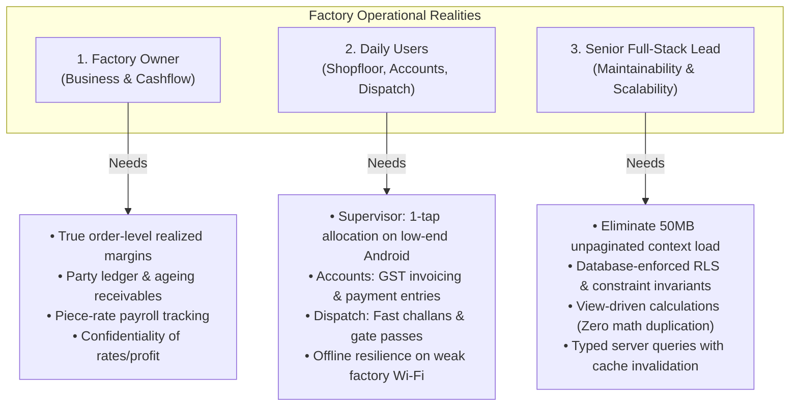
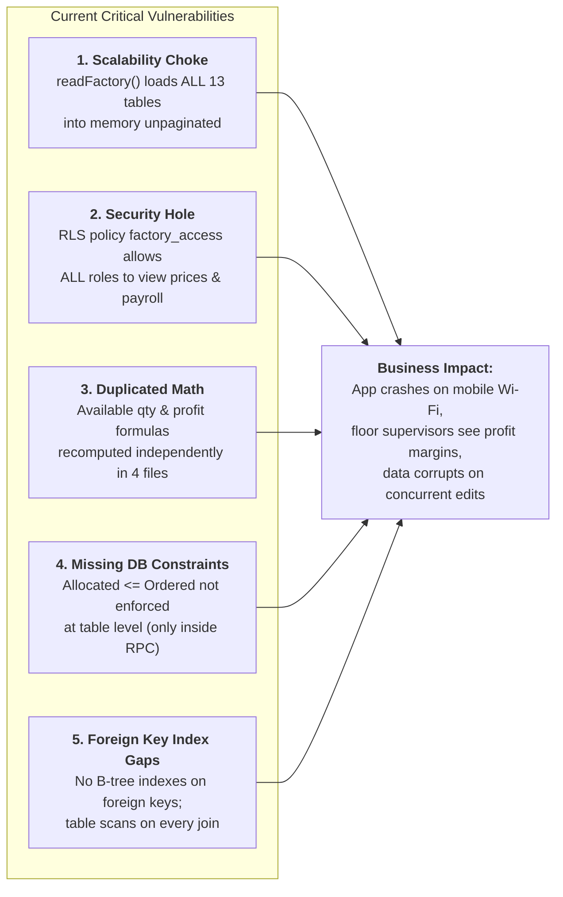

# CrateERP Architecture Review & Production Roadmap (Phase 0)

**Document Version:** 1.0.0  
**Target Architecture:** Wooden Box, Crate & Industrial Packaging Manufacturing ERP  
**Author Perspectives:** Factory Owner, Daily Shopfloor & Backoffice Operators, Senior Full-Stack Engineer  
**Status:** Approved for Foundation Planning (Phase 0 Complete — No Code Modifications)

---

## 1. Executive Persona Analysis

To transition CrateERP from a functional demo into software the business cannot run without, the system must simultaneously address three distinct realities:



### 1.1 The Factory Owner's Lens
- **Intake & Chaos:** Orders arrive via WhatsApp voice notes, photos of sketches, and phone calls. The system must allow creating an order in under 45 seconds, with optional quote-to-order conversion.
- **Realized Margin, Not Paper Margin:** A box quoted at ₹450 with ₹50 estimated timber and ₹25 labour can easily lose money if extra transport charges, timber wastage, rework, or shared factory diesel costs aren't tracked. The owner needs realized profit computed from confirmed dispatches, actual piece rates, and allocated freight.
- **Cash Flow & Ageing:** Clients pay in 30, 60, or 90 days. Knowing total revenue is useless without knowing who has exceeded their credit limit, which bills are overdue, and sending WhatsApp payment reminders with invoice amounts.
- **Strict Data Privacy:** Floor supervisors and machine operators must never see customer selling rates, invoice totals, factory revenue, or master profit margins.

### 1.2 The Daily Users' Lens
- **Production Supervisor (Floor Operator):** Uses a budget Android smartphone with cracked glass and dusty hands over spotty factory Wi-Fi. Needs large tap targets, high contrast, zero tiny data tables, printable job cards with box specs/dimensions, and instant piece-completion entry without loading customer financial data.
- **Accounts Clerk:** Needs clean GST-compliant tax invoicing generated directly from dispatched delivery challans (HSN codes, CGST/SGST/IGST breakdown, round-off, partial billings), party ledger statements, and advance borrowing reconciliations.
- **Dispatch Clerk:** Working at the loading dock amidst roaring trucks. Needs rapid vehicle/transporter/LR entry, printable delivery challans, gate passes, and packing slips. Must never see price details on delivery documents.

### 1.3 The Senior Full-Stack Developer's Lens
- **Technical Longevity:** The software must run reliably over 5+ years as the database grows to 100,000+ orders, 500,000+ allocations, and 250,000+ challan line items.
- **Database Integrity First:** The database must be the single source of truth. Calculations for available inventory, completed boxes, and realized margins belong in PostgreSQL views or generated columns—never duplicated across React UI components.
- **Security & Authorization:** "Any authenticated user can read everything" is unacceptable. Strict PostgreSQL Row-Level Security (RLS) must gate financial columns and tables at the SQL layer.

---

## 2. Technical Audit: What is Good vs. What is Risky

### 2.1 The Good
1. **Modern Foundation:** Built on TanStack Start (React 19 + Nitro engine), TanStack Router, TanStack Query, Radix UI, and Supabase. Fast cold-starts and clean bundle footprint.
2. **Transactional RPC Core:** The `public.factory_action(action text, payload jsonb)` RPC provides transactional integrity for multistep workflows (allocating, completing, creating challans, confirming dispatches, and disbursing payroll).
3. **Optimized Design Language:** The visual theme, sidebar structure, responsive desktop tables, and card views are clean, readable, and responsive.
4. **Complete Migration Foundation:** Recent migrations (`0002_payroll_disbursements.sql` and `0003_factory_action_v2.sql`) fixed negative payroll deductions, implemented oldest-first advance recovery, added challan cancellation with reservation release, and added order short-closure controls.

---

### 2.2 Critical Risks & Architectural Flaws



#### Risk 1: Scalability Collapse (`FactoryData` "Load Everything" Pattern)
- **Current Code:** In `src/components/erp/provider.tsx`, `readFactory()` executes `Promise.all` fetching `select('*')` on all 13 database tables simultaneously on app load.
- **Consequence:** At 50,000 orders and 150,000 allocations, this payload will exceed 40–80 MB of uncompressed JSON. Budget Android phones will experience Out-Of-Memory (OOM) browser tab crashes, and factory Wi-Fi will time out.
- **Remedy:** Eliminate monolithic global loading. Convert each view to independent, server-paginated TanStack Query hooks (`useOrders`, `useAllocations`, `useChallans`) with URL-synced search, filtering, and page parameters.

#### Risk 2: Severe RLS Data Leakage
- **Current Code:** `0000_crate_erp_foundation.sql` creates:
  ```sql
  CREATE POLICY factory_access ON public.orders FOR ALL TO authenticated USING (true) WITH CHECK (true);
  CREATE POLICY factory_access ON public.labour_payroll FOR ALL TO authenticated USING (true) WITH CHECK (true);
  CREATE POLICY factory_access ON public.order_items FOR ALL TO authenticated USING (true) WITH CHECK (true);
  ```
- **Consequence:** Any user logged into the app (including a floor supervisor or third-party forklift operator) can inspect browser network traffic or run Supabase queries directly to view unit rates, customer order values, worker wages, and factory profits.
- **Remedy:** Replace permissive policies with a role-based security matrix (`Owner/Admin`, `Manager`, `Supervisor`, `Accountant`, `Dispatch Clerk`, `Viewer`). Secure financial views (`v_order_financials`, `v_labour_payroll_secure`) accessible only to administrative roles.

#### Risk 3: Duplicated Business & Financial Math
- **Current Code:**
  - Available inventory (`completed_qty - dispatched_qty - reserved_qty`) is computed in `dispatch.tsx`, `dashboard.tsx`, and `orders.tsx`.
  - Realized profit is computed in `src/lib/erp-data.ts:finance()`, but order totals and progress percentages are computed separately in `orders.tsx` and `volume-charts.tsx`.
- **Consequence:** Discrepancies emerge between what the dashboard reports, what Order Entry displays, and what accounting calculates.
- **Remedy:** Move calculations into database views (`v_order_items_summary`, `v_order_realized_profit`, `v_inventory_ready`). The frontend becomes a presentation layer.

#### Risk 4: Invariants Missing at the Table Constraint Level
- **Current Code:** While `factory_action` checks quantities during RPC execution, direct database inserts or third-party integrations can insert `allocated_qty > ordered_qty` or `dispatched_qty > completed_qty` because `order_items` only checks `CHECK(0<=dispatched_qty AND dispatched_qty+reserved_qty<=completed_qty AND completed_qty<=allocated_qty AND allocated_qty<=ordered_qty)` on that specific table. If someone modifies orders or allocations directly, inconsistencies occur.
- **Remedy:** Implement PostgreSQL triggers to guard operational invariants across table boundaries.

#### Risk 5: Index Gaps and Table Scans
- **Current Code:** No secondary indexes exist on foreign key columns (`order_items.order_id`, `production_allocations.order_item_id`, `production_allocations.labour_id`, `challan_items.challan_id`, `delivery_challans.order_id`, `expenses.reference_dc_id`).
- **Consequence:** PostgreSQL performs sequential table scans for foreign key lookups and cascading checks, degrading query performance from 2ms to 1,500ms as data scales.
- **Remedy:** Add composite and single-column B-tree indexes for all join paths and frequent search/filter predicates.

#### Risk 6: Schema Drift & Loose TypeScript Types
- **Current Code:** `src/integrations/supabase/types.ts` is manually maintained and severely desynchronized from the actual database schema:
  - `labour_payroll_disbursements` table is completely missing from `types.ts`.
  - `orders` audit columns (`closed_short`, `close_short_reason`, `closed_short_at`, `closed_short_by`) are missing from `types.ts`.
  - `production_allocations.completion_alert_sent_at` is missing from `types.ts`.
  - `orders.status` is typed as `'Pending' | 'In Production' | 'Dispatched' | 'Completed' | 'Cancelled'`, missing `'Partially Dispatched'`.
  - `labour_payroll.status` is typed as `'Pending' | 'Paid'`, missing `'Partially Paid'`.
  - `delivery_challans.status` is typed without `'Cancelled'`.
- **Remedy:** Re-generate types using `supabase gen types typescript` after migration 0004.

#### Risk 7: Leftover Corrugated-Board & Sales-CRM Vocabulary
- **CSS / UI Classes:** `src/components/erp/orders.tsx` and `src/styles.css` still utilize CRM template classes: `.deals-board`, `.deals-column`, `.deals-card`, `.deals-card-top`, `.deals-card-title`, `.deals-card-metric`.
- **Schema Columns:**
  - `order_items.priority_signal` ('Red', 'Yellow', 'Green') remains from CRM visual ticketing.
  - `order_items.box_type` remains specific to boxes rather than general packaging (crates, skids, pallets).
  - `orders.medium` ('WhatsApp', 'Call', 'Mail', 'Other') reflects informal CRM lead intake.
- **Seed Data:** Legacy comments in `0000` reference flute/board terminology in past commits; frontend placeholders were converted to "Timber / Plywood type, thickness, finish, joint type".

---

## 2.3 Existing Operational Architecture Deep Dive

### A. Two-Tier Payroll Payment Model
1. **Accrual / Run Stage (`factory_action('payroll')`):**
   - Calculates gross unpaid earnings across completed allocations: `sum(completed_qty * labour_rate - paid_earnings)`.
   - Computes total outstanding debt across `labour_borrowings`: `sum(amount - deducted_amount)`.
   - Caps deduction at `LEAST(earnings, debt)` so net pay is strictly non-negative ($\ge 0$).
   - Deducts advances oldest-first by updating `labour_borrowings.deducted_amount`.
   - Marks allocations as paid by setting `paid_earnings = completed_qty * labour_rate`.
   - Inserts into `labour_payroll` with `gross`, `deductions`, `net_paid`, `amount_paid = 0`, and status `'Pending'` (or `'Paid'` if net is 0).
2. **Disbursement Stage (`factory_action('disburse')`):**
   - Admin-only action. Inserts into `labour_payroll_disbursements` (`payroll_id`, `amount`, `payment_mode`, `reference_notes`, `disbursed_at`, `disbursed_by`).
   - Database trigger `fn_apply_payroll_disbursement()` executes `AFTER INSERT`:
     - Checks total disbursements against `net_paid`. Rejects overpayments with an exception.
     - Updates `labour_payroll.amount_paid = sum(disbursements)`.
     - Automatically transitions status: `'Paid'` when fully disbursed, `'Partially Paid'` if $>0$ but $<$ net, `'Pending'` if $0$.

### B. Labour-to-Challan Traceability
- **Method:** In `factory_action('challan')`, when items are attached to a delivery challan:
  ```sql
  SELECT COALESCE(sum(completed_qty * labour_rate) / NULLIF(sum(completed_qty), 0), 0)
    INTO rate FROM production_allocations WHERE order_item_id = item.id;
  INSERT INTO challan_items(challan_id, order_item_id, dispatched_qty, direct_labour_cost)
    VALUES(rid, item.id, qty, qty * rate);
  ```
- **Strengths:** Accurately reflects the weighted average piece rate of the workers who built that batch.
- **Limits:** If multiple workers completed pieces at different rates (e.g. day shift ₹12 vs night shift ₹15), it blends them into an average rather than tracking physical piece FIFO. If an allocation is completed *after* a partial challan is created, subsequent challans re-average based on then-completed pieces.

### C. Dispatch Reservation Cycle
1. **Creation (`action('challan')`):**
   - Available inventory is computed as: `available = completed_qty - dispatched_qty - reserved_qty`.
   - Creating a challan in `'Delivery Challan Made'` status increments `order_items.reserved_qty` by the requested quantity.
   - Prevents double-shipping or creating duplicate challans for the same completed inventory.
2. **Dispatch Confirmation (`action('dispatch')`):**
   - Decrements `order_items.reserved_qty` and increments `order_items.dispatched_qty`.
   - Updates challan status to `'Dispatched'`.
   - Updates order status: `'Completed'` if all line items are fully dispatched, otherwise `'Partially Dispatched'`.
3. **Cancellation (`action('cancel_challan')`):**
   - Only permitted for challans in `'Delivery Challan Made'` status.
   - Decrements `reserved_qty` back to 0 without altering `dispatched_qty`.
   - Immediately releases the completed boxes back into the available pool.

### D. Scheduled Jobs Architecture
- **Worker Process:** Hosted inside `src/server.ts` as an intercepted HTTP route (`/api/cron/check-tentative-completions`) executed on a recurring timer (external cron / Cloudflare cron / monitoring ping).
- **Security:** Requires `x-cron-secret` header verified using constant-time string comparison (`constantTimeEqual`) against `process.env.CRON_SECRET`.
- **Logic:** Queries `production_allocations` where `tentative_completion <= now() AND completion_alert_sent_at IS NULL AND completed_qty < allocated_qty`.
- **Deduplication:** Immediately marks `completion_alert_sent_at = now()` so an allocation alerts exactly once.
- **Notification:** Inserts into `factory_notifications` and dispatches encrypted Web Push payloads via `@block65/webcrypto-web-push` to approved subscriptions using `push_configuration` ECDSA keys.

### E. Tables or Columns UI Uses Without Migration
- **Local Storage Role Mirroring:** `src/components/erp/provider.tsx` stores roles in `localStorage.getItem('crate_user_roles')` as an offline resilience mechanism. If the database `user_roles` query succeeds, local storage is updated, but if empty, it falls back to local storage.
- **Unmigrated Columns:** None. All operational database columns queried by the UI exist in the schema, though several newly added columns from migrations 0002 and 0003 are missing from `types.ts`.

---

## 3. Gap Analysis Against Phase Requirements

| Phase & Functional Need | Current State in Codebase | Architectural Gap to Bridge |
| :--- | :--- | :--- |
| **Phase 1: Foundation & Data Integrity** | Permissive RLS (`USING (true)`). Monolithic client-side loading. | Build 6-role permission matrix; implement server-side pagination with TanStack Query; create database views for inventory & profit; add financial-year number series generator; implement soft deletes & audit logging. |
| **Phase 2: Money (Quotes, Invoices, Ledgers)** | Orders exist, but zero quote, tax invoice, or customer payment tables. | Create `quotations`, `quotation_items`, `tax_invoices`, `invoice_items`, `party_payments`, and `party_price_lists`. Build GST tax engine (CGST/SGST/IGST), ageing ledger view (0-30, 31-60, 61-90, 90+ days), and printable PDFs. |
| **Phase 3: Production Depth & Materials** | Single allocation per item. No raw materials or BOM. | Create `raw_materials`, `bill_of_materials`, `material_transactions`, `supplier_master`, and `job_cards`. Add QC rejection/rework logging, finished-goods inventory ledger, and stage tracking (Cutting, Assembly, Nailing, QC, Packing). |
| **Phase 4: Labour Management** | Piece-rate completed quantity tracked. Basic borrowings & payroll disbursements. | Add daily attendance tracking (Present, Half-day, Overtime) for day-rate workers; combine piece-rate and day-rate in single payroll run; generate printable pay slips; add productivity leaderboards for managers. |
| **Phase 5: Dispatch Depth** | Challan creation, confirmation, and cancellation working. | Add `transporter_master`, e-way bill fields, proof-of-delivery (POD) photo/document uploads, gate pass generation, and freight expense allocation across invoice lines. |
| **Phase 6: Daily-Use Experience** | Static role displays in header; search is client-side in filtered array. | Build role-tailored "Today" dashboard view; add global `Ctrl+K` search palette; implement offline mutation queue with local persistence; add Hindi/Gujarati language localization toggles. |
| **Phase 7: Quality & Performance** | One smoke test script (`smoke_test.sql`). | Build automated Vitest test suite; write realistic 50,000-row seed generator; document disaster recovery, backup, and role-based onboarding guides. |

---

## 4. Current Conflicts with Prompt Rules

1. **Rule Conflict: Privacy & Role Enforcement**
   - *Prompt Rule:* "Prices, rates, profit and payroll must be hidden from roles that should not see them, enforced in the database (RLS or views), not just in the UI."
   - *Current Code:* Currently, any authenticated user can read `order_items.unit_rate`, `labour_payroll.gross`, `labour_payroll.net_paid`, and `expenses.amount`. This will be resolved in Phase 1 by dropping permissive RLS policies and routing non-admin roles through sanitized views.
2. **Rule Conflict: Data Integrity Invariants**
   - *Prompt Rule:* "Allocated <= ordered, completed <= allocated and dispatched <= completed can never be violated, even by a buggy client."
   - *Current Code:* While `factory_action` contains validations, direct inserts or edge-case partial edits can leave unreserved or over-allocated entries. This will be secured with database triggers and strict check constraints.
3. **Rule Conflict: Date Range Payroll Scope**
   - *Finding from Phase 0 Audit:* Running payroll currently marks **all** unpaid allocations for a worker as paid across all time, ignoring any date range selected in the UI. Phase 4 will explicitly scope payroll runs to date windows.

---

## 5. Proposed Folder & Module Structure

To maintain separation of concerns without disrupting the active application, the codebase will be organized into domain-driven feature modules:

```text
e:/ERP-box/slb/
├── docs/
│   ├── ARCHITECTURE_REVIEW.md       # (This Document - Phase 0)
│   ├── PERMISSIONS_MATRIX.md         # Role-based security specifications
│   └── DATABASE_SCHEMA.md            # Comprehensive data dictionary
├── drizzle/
│   └── migrations/                   # Drizzle schema migrations
├── supabase/
│   ├── migrations/                   # Supabase SQL Editor migration files
│   └── tests/                        # Self-contained rollback smoke tests
├── src/
│   ├── components/
│   │   ├── erp/
│   │   │   ├── common/               # Design-system primitives (Pills, Meters, Tabs, Skeletons)
│   │   │   ├── dashboard/            # Role-tailored "Today" dashboard & metrics
│   │   │   ├── sales/                # Quotes, Order Entry, Party Price Lists
│   │   │   ├── production/           # Allocations, Job Cards, Stages, QC
│   │   │   ├── inventory/            # Timber/Plywood Raw Materials, BOM, Finished Stock
│   │   │   ├── dispatch/             # Delivery Challans, Gate Passes, Transporters, POD
│   │   │   ├── billing/              # GST Tax Invoices, Payments, Party Ledger & Ageing
│   │   │   ├── labour/               # Attendance, Advances, Piece-rate & Day-rate Payroll
│   │   │   ├── masters/              # Party Master, Item Master, Transporters, Suppliers
│   │   │   └── admin/                # Audit Logs, Role Handover, Company Profile
│   │   └── ui/                       # Radix UI foundational wrappers
│   ├── hooks/                        # Paginated server queries (useOrdersQuery, useFinanceQuery)
│   ├── lib/
│   │   ├── erp-data.ts               # Formatting utilities (₹ Lakh/Crore, IST dates)
│   │   ├── push.ts                   # Web push notification client
│   │   └── formatters.ts             # Currency, date, and dimension converters
│   ├── server/                       # Server-only endpoints (Cron, Webhooks, PDF generation)
│   └── routes/                       # TanStack Start file-based routing
```

---

## 6. Implementation Strategy (Phase-by-Phase Execution Plan)

In accordance with global instructions:
- Work proceeds **ONE PHASE AT A TIME**.
- Before coding each phase, the design will detail:
  1. **The exact operational problem solved** for the owner or floor operators.
  2. **The schema and migration changes** (SQL).
  3. **The new or changed screens**.
  4. **The verification and test procedure**.
- Once presented, work **STOPS** and awaits explicit approval before executing any code changes.

---

### Ready for Phase 1 Proposal
Phase 0 Architecture Review is complete. The next step is **Phase 1: Foundation and Data Integrity**.
